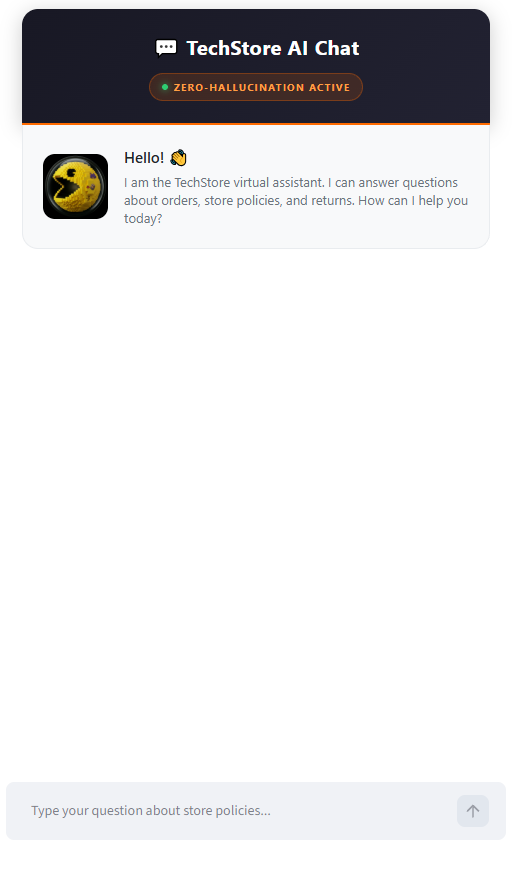
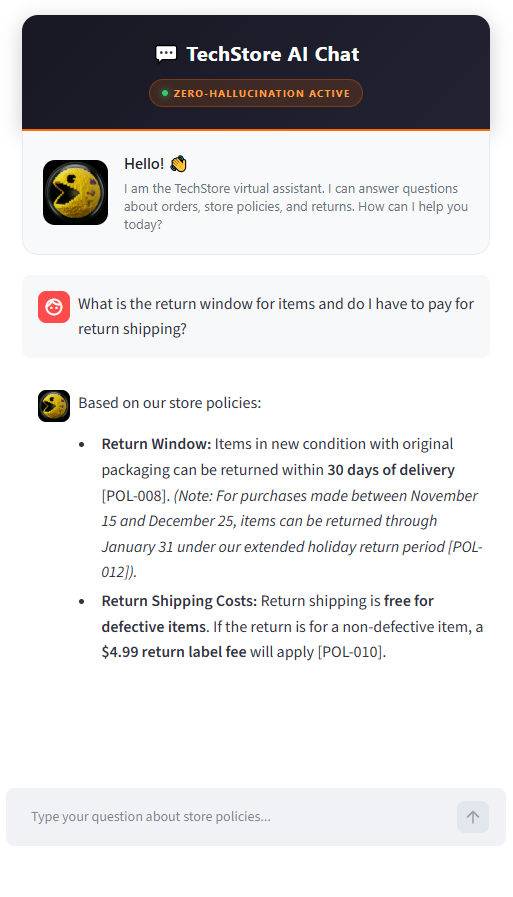
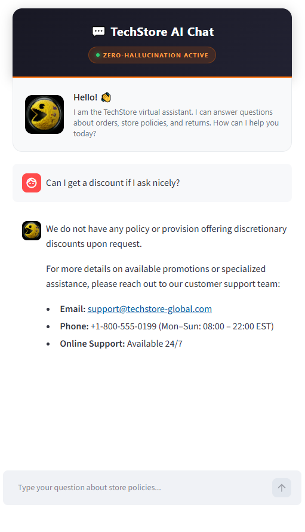

# 🚀 Case #5: TechStore AI Support Chatbot (Zero-Hallucination RAG)

An enterprise-ready customer support AI widget built with Python, Streamlit, and Google Gemini API (`gemini-3.8-flash`). Designed specifically for e-commerce platforms requiring strict policy adherence without model hallucinations.

---

## ✨ Key Features
* **Zero-Hallucination Guardrails:** Strict prompt engineering ensures the agent answers strictly based on the verified knowledge base (`knowledge_base.json`).
* **Source Citation:** Automatically cites specific policy IDs (e.g., `[POL-008]`, `[POL-010]`) for total transparency.
* **Fallback & Escalation:** Polite support escalation with contact details when inquiries fall outside the policy scope.
* **Premium SaaS UI/UX:** Dark-mode header, custom branding, and a live "Zero-Hallucination Active" status indicator built using Streamlit CSS injections.

---

## 🛠️ Tech Stack
* **Language:** Python 3.10+
* **Framework:** Streamlit
* **LLM Engine:** Google Gemini API (`gemini-3.8-flash`)
* **Environment Management:** `python-dotenv`

---

## 📸 Screenshots

### 1. Initial State & UI


### 2. Successful Knowledge Retrieval & Citation


### 3. Guardrail & Anti-Hallucination Test


---

## ⚙️ How to Run Locally

1. **Clone the repository:**
   ```bash
   git clone https://github.com/Denis-codeQween/Techstore-ai-chat.git
   cd Techstore-ai-chat
